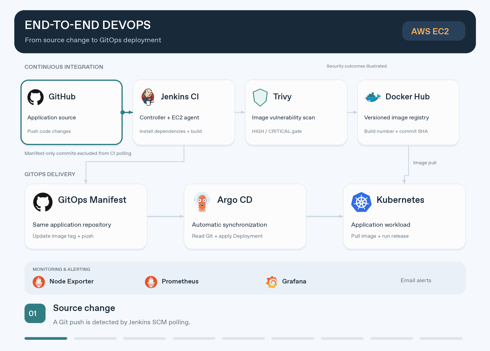
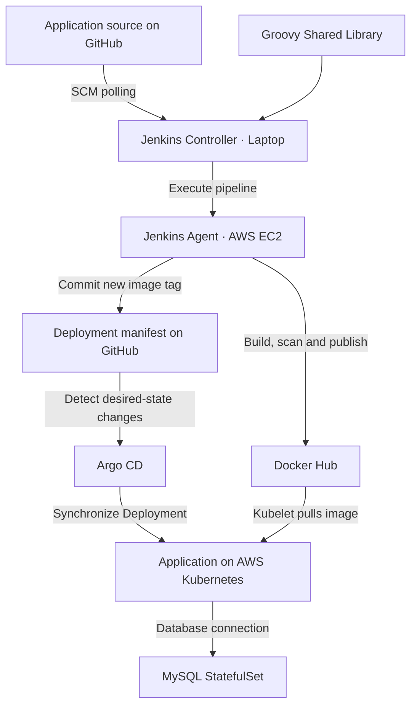
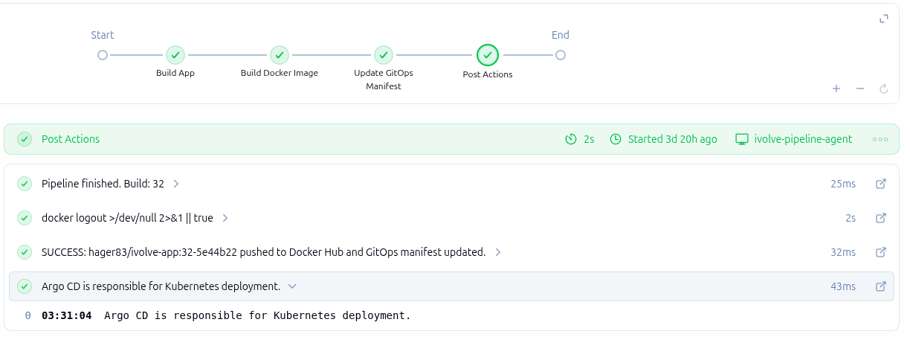

# End-to-End DevOps Project
### One application. From Docker Compose to automated GitOps delivery on AWS.

I containerized a **Node.js and MySQL application**, deployed it on an AWS-hosted Kubernetes cluster, and automated its delivery using **Jenkins and Argo CD**—with image vulnerability scanning, persistent storage, network controls, and infrastructure monitoring.

**AWS EC2 · Docker · Kubernetes · Jenkins · Groovy · Trivy · Argo CD · Prometheus · Grafana**

## At a Glance

| Delivery | Infrastructure | Visibility |
|---|---|---|
| Automated CI and GitOps deployment | kubeadm cluster on AWS EC2 | Grafana node dashboards |
| Dedicated EC2 build agent | Persistent application and database storage | Prometheus metrics |
| Versioned, security-scanned images | RBAC and database NetworkPolicy | Alertmanager email notifications |

## See It in Action

A source change starts Jenkins CI. The EC2 agent builds and scans the image, publishes it to Docker Hub, and commits the updated image reference to Git. **Argo CD picks up the manifest change and deploys it to Kubernetes.**

## How It Works

**Jenkins prepares the release. Git records the desired version. Argo CD deploys it.**

Application source and deployment manifests share one repository. Jenkins ignores manifest-only changes during SCM polling to prevent a CI feedback loop.

## What I Built

### What I Implemented

| Area | Implementation |
|---|---|
| **Containerization** | Packaged the Node.js application with Docker and ran the application/MySQL stack using Docker Compose. |
| **AWS Infrastructure** | Provisioned EC2 instances for the Kubernetes control plane, worker node, and dedicated Jenkins build agent. |
| **Kubernetes** | Configured a kubeadm cluster with Calico, an application Deployment, and a MySQL StatefulSet with a Headless Service. |
| **Configuration & Storage** | Used ConfigMaps, Secrets, and PersistentVolumes for database data and application logs. |
| **Security & Access** | Configured Kubernetes RBAC, Jenkins role-based authorization, registry credentials, and MySQL ingress restrictions. |
| **Resource Management** | Applied CPU/memory requests and limits, node labels, taints, tolerations, and Metrics Server. |
| **Continuous Integration** | Automated dependency installation, Docker builds, Trivy security checks, and versioned image publication. |
| **Pipeline Reusability** | Created a Groovy Shared Library and executed pipelines on a dedicated EC2 agent. |
| **GitOps Delivery** | Automated deployment manifest updates through Jenkins and Kubernetes synchronization through Argo CD. |
| **Monitoring & Alerting** | Collected node metrics with Prometheus, built Grafana dashboards, and verified Alertmanager email notifications. |

### Containerized Application

- Packaged the Node.js application as a Docker image with production dependencies.
- Used Docker Compose for the application, MySQL, networking, and persistent volumes.
- Verified database connectivity, persisted records, and HTTP health endpoints.

### Kubernetes Infrastructure on AWS

- Configured a two-node **kubeadm cluster** with containerd and Calico.
- Deployed the application and a **MySQL StatefulSet** with a Headless Service.
- Configured ConfigMaps, Secrets, persistent storage, and private image pulls.
- Applied resource requests and limits, scheduling constraints, Kubernetes RBAC, and a NetworkPolicy restricting MySQL ingress.

### Reusable Jenkins CI

Moved pipeline execution to a dedicated **AWS EC2 agent**, selected through the `docker-k8s` label.

| Shared Library Function | Responsibility |
|---|---|
| `buildApp()` | Check out source, install dependencies, and generate the image tag. |
| `buildImage()` | Build the image, scan with Trivy, publish to Docker Hub, and remove the local tag. |
| `updateGitOpsManifest()` | Update the deployment image reference, commit, and push to GitHub. |

Images use a **build-number + commit-hash** tag, connecting each release to its source.

**Security gate:** HIGH or CRITICAL Trivy findings stop the pipeline before image publication.

### GitOps Deployment

Replaced Jenkins-driven `kubectl apply` with **Argo CD automatic synchronization**.

Jenkins no longer deploys directly to the cluster. It updates the manifest in Git; Argo CD reconciles the application Deployment.

| Argo CD Setting | Configuration |
|---|---|
| Watched path | `kubernetes/` |
| Target namespace | `ivolve` |
| Automatic synchronization | Enabled |
| Automatic pruning | Disabled |
| Self-healing | Disabled |

### Monitoring & Alerting

Collected node metrics using **Node Exporter and Prometheus**, visualized them in **Grafana**, and verified **Alertmanager email delivery** with a test alert.

## Verified Results

| Check | Recorded Outcome |
|---|---|
| Application health | `/health` and `/ready` returned **HTTP 200**. |
| Data persistence | Product records survived Compose service restarts. |
| Image security | Demonstrated scan reported **0 HIGH / CRITICAL findings**. |
| Remote pipeline execution | Completed on **`ivolve-pipeline-agent`**. |
| Image publishing | Versioned images successfully pushed to Docker Hub. |
| GitOps delivery | Argo CD reached **Synced / Healthy**; Kubernetes rollout completed. |
| Database isolation | Matching Pod traffic reached MySQL; unauthorized Pod traffic timed out. |
| Email alerting | Test notification received successfully. |

*Security results reflect the recorded scan and its vulnerability database at that time.*

## Key Engineering Decisions

- **Separate CI and CD:** Jenkins handles release preparation; Argo CD handles deployment.
- **Reuse automation:** Shared Library functions keep the Jenkinsfile focused on project configuration.
- **Preserve traceability:** Versioned image references and Git commits make releases identifiable.
- **Prevent recursive builds:** Exclude GitOps-only changes and preserve the workspace needed for path-based polling.

**Implementation boundaries:** This environment uses one application replica with `Recreate` updates, node-local storage, and a manually maintained Jenkins reverse SSH tunnel. Argo CD manages the application Deployment; supporting resources were provisioned separately.

## Explore the Implementation

| Source | Contents |
|---|---|
| [Application](application) | Application code, Docker configuration, Jenkinsfile, and deployment manifest. |
| [Shared Library](shared-library) | Reusable Jenkins pipeline functions. |
| [Implementation Documentation](https://github.com/Hager-83/iVolve-training) | Configuration steps, troubleshooting, and additional evidence. |

The source submodules are pinned to the **Lab 23 portfolio snapshots**, preserving the implementation presented here.

---

---

**Implemented and documented by Hager Shohieb**  
Developed during iVolve training under the guidance of **Eng. Ibrahim Adel**.