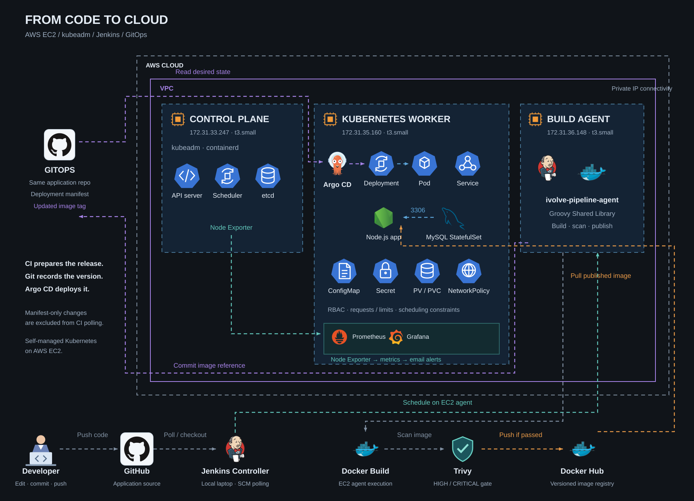

# End-to-End DevOps Project

### Containerization, Kubernetes infrastructure, and automated GitOps delivery on AWS.

I built the infrastructure and delivery workflow around an existing **Node.js and MySQL application**: from Docker Compose validation to a kubeadm cluster, Jenkins CI, Argo CD deployment, and infrastructure monitoring.

**AWS EC2 · Docker · Kubernetes · Jenkins · Groovy · Trivy · Argo CD · Prometheus · Grafana · Alertmanager**

## Project Architecture

The project connects a local Jenkins controller, a dedicated EC2 build agent, and a self-managed Kubernetes cluster on AWS.



**Delivery workflow**

1. The developer pushes application changes to GitHub.
2. Jenkins detects the change and schedules the pipeline on the EC2 agent.
3. The agent builds the Docker image and scans it with Trivy. HIGH or CRITICAL findings stop publication.
4. After a successful scan, Jenkins publishes the versioned image to Docker Hub and commits its reference to the deployment manifest.
5. Argo CD detects the manifest change and automatically synchronizes the application Deployment.
6. Kubernetes pulls the image and runs the updated application.

**Monitoring:** Node Exporter exposes node metrics, Prometheus collects them, Grafana displays dashboards, and Alertmanager sends configured email notifications.

Application code and the deployment manifest share one repository. Manifest-only commits are excluded from Jenkins SCM polling to prevent recursive builds.

## Contents

1. [AWS Infrastructure](#1-aws-infrastructure)
2. [Kubernetes Cluster Setup](#2-kubernetes-cluster-setup)
3. [Application and Database Deployment](#3-application-and-database-deployment)
4. [Jenkins Controller and EC2 Agent](#4-jenkins-controller-and-ec2-agent)
5. [CI Pipeline and Shared Library](#5-ci-pipeline-and-shared-library)
6. [GitOps Deployment with Argo CD](#6-gitops-deployment-with-argo-cd)
7. [Monitoring and Alerting](#7-monitoring-and-alerting)
8. [Final Results and Demo](#8-final-results-and-demo)

## What I Implemented

| Area | Implementation |
|---|---|
| Infrastructure | Three AWS EC2 instances and a two-node kubeadm cluster. |
| Application platform | Docker Compose, Kubernetes workloads, persistent storage, and configuration management. |
| Security | RBAC, database NetworkPolicy, registry authentication, and image vulnerability scanning. |
| CI automation | Jenkins controller, dedicated EC2 agent, and reusable Groovy functions. |
| GitOps delivery | Automated image-reference commits and Argo CD synchronization. |
| Monitoring | Node metrics, Grafana dashboards, and email notifications. |

## 1. AWS Infrastructure

The recorded environment uses three **t3.small** Ubuntu EC2 instances within the same VPC.

| Machine | Private IP | Responsibility |
|---|---|---|
| Kubernetes control plane | `172.31.33.247` | Kubernetes API and control-plane components. |
| Kubernetes worker | `172.31.35.160` | Application, database, and supporting workloads. |
| Jenkins agent | `172.31.36.148` | Remote CI execution. |

### Implementation

- Provisioned the instances and configured private connectivity.
- Configured security-group rules for Kubernetes and Calico traffic.
- Prepared SSH access and administration tunnels.
- Expanded compute and storage resources where required.

### Verification — EC2 Instances Running


## 2. Kubernetes Cluster Setup

Built a Kubernetes cluster directly on EC2 using **kubeadm**, with **containerd** as the runtime and **Calico** for Pod networking.

| Component | Configuration |
|---|---|
| Nodes | One control plane and one worker |
| Kubernetes version in recorded verification | `v1.35.9` |
| Runtime | containerd |
| Networking | Calico |
| Application namespace | `ivolve` |

### Implementation

1. Prepared both nodes and verified available resources and IPv4 forwarding.
2. Installed containerd, kubeadm, kubelet, and kubectl.
3. Initialized the control plane and configured administrator access.
4. Installed Calico and joined the worker.
5. Added worker labels, taints, and workload tolerations.

The control-plane initialization command:

```bash
sudo kubeadm init \
  --apiserver-advertise-address=172.31.33.247 \
  --pod-network-cidr=192.168.0.0/16
```

### Verification — Nodes Ready and System Pods Running

Both nodes reached `Ready`. Calico, CoreDNS, and the essential control-plane components were running.


[View cluster setup commands and configuration](https://github.com/Hager-83/iVolve-training/tree/main/Kubernetes/Lab9)

## 3. Application and Database Deployment

### Local Container Validation

Packaged the application with Docker and configured a Compose stack containing the application, MySQL, a private bridge network, and persistent volumes.

Database settings are supplied through environment variables. The local `.env` file is excluded from Git.

```bash
docker compose up -d --build
docker compose ps
```

**Verification — application and database containers running:**


**Verification — health and readiness endpoints returning HTTP 200:**


### Kubernetes Resources

| Resource | Purpose |
|---|---|
| Deployment `ivolveapp` | Runs the Node.js application. |
| Service `ivolvaappsvc` | Provides application access inside the cluster. |
| StatefulSet `ivolvedb` | Runs MySQL with a stable Pod identity. |
| Headless Service `ivolvedbsvc` | Provides database discovery. |
| ConfigMap and Secret | Supply database configuration and credentials. |
| PVs and PVCs | Preserve database data and application logs. |

### Workload Configuration

- Added database initialization, readiness, and liveness checks.
- Mounted persistent storage for MySQL data and application logs.
- Configured resource requests, limits, and worker scheduling constraints.
- Restricted MySQL ingress to matching application Pods on TCP port `3306`.
- Configured private image pulls using a registry Secret.

The application was later adjusted to **one replica with Recreate updates** to fit the available worker capacity.

### Verification — Persistent Storage Bound


### Verification — Application and Database Running

The recorded deployment has one available application replica, with both application and database Pods running.


[Dockerfile](https://github.com/Hager-83/ivolve-app-cicd/blob/lab23-portfolio-v1/Dockerfile) · [Compose configuration](https://github.com/Hager-83/ivolve-app-cicd/blob/lab23-portfolio-v1/docker-compose.yml) · [Deployment manifest](https://github.com/Hager-83/ivolve-app-cicd/blob/lab23-portfolio-v1/kubernetes/deployment.yaml)

## 4. Jenkins Controller and EC2 Agent

Configured Jenkins as a Linux service on the laptop, then moved pipeline execution to a dedicated AWS EC2 agent.

### Controller Setup

- Completed Jenkins installation and initial configuration.
- Configured the required plugins and Pipeline job.
- Implemented administrator and read-only roles.
- Added GitHub and Docker Hub credentials.

**Verification — Jenkins service active:**


### Agent Preparation

Installed Java, Git, Node.js, npm, Docker, Trivy, Python, and kubectl. Created a dedicated `jenkins` user and configured its working directory and Docker access.

| Setting | Value |
|---|---|
| Node name | `ivolve-pipeline-agent` |
| Pipeline label | `docker-k8s` |
| Executors | `1` |
| Working directory | `/home/jenkins/agent` |
| Connection | WebSocket through a reverse SSH tunnel |

**Verification — Docker access for the Jenkins user:**


**Verification — agent connected:**


[Controller configuration](https://github.com/Hager-83/iVolve-training/tree/main/Jenkins/Lab20) · [Agent installation and connection](https://github.com/Hager-83/iVolve-training/tree/main/Jenkins/Lab22)

## 5. CI Pipeline and Shared Library

Separated application code from reusable pipeline logic.

| Repository | Contents |
|---|---|
| `ivolve-app-cicd` | Application, Docker configuration, Jenkinsfile, and Kubernetes deployment manifest. |
| `iVolve-jenkins-shared-library` | Reusable Groovy pipeline functions. |

The application and deployment manifest remain in the **same repository**.

### Shared Library Functions

| Function | Responsibility |
|---|---|
| `buildApp()` | Checkout, dependency installation, and image-tag generation. |
| `buildImage()` | Docker build, Trivy scan, Docker Hub publication, and local tag removal. |
| `updateGitOpsManifest()` | Update the deployment image reference, commit, and push. |

### CI Workflow

1. SCM polling detects a source change.
2. The EC2 agent installs dependencies and builds the image.
3. Trivy checks for HIGH and CRITICAL vulnerabilities.
4. Images that pass the scan are published with a build-number and commit-based tag.
5. Jenkins commits the image reference to Git.

**Security gate:** A failing Trivy check stops publication.

### Verification — Pipeline Execution


### Verification — Versioned Image Published

The recorded image tag connects the artifact to its Jenkins build and source revision.


### Prevent CI Feedback Loops

Configured polling to ignore changes affecting only `kubernetes/`, and preserved the workspace required for changed-path filtering.

Credentials are supplied through Jenkins bindings rather than embedded in the pipeline.

[Jenkinsfile](https://github.com/Hager-83/ivolve-app-cicd/blob/lab23-portfolio-v1/Jenkinsfile) · [Shared Library code](https://github.com/Hager-83/iVolve-jenkins-shared-library/tree/lab23-portfolio-v1/vars)

## 6. GitOps Deployment with Argo CD

Replaced direct Jenkins deployment with **GitOps**: Jenkins updates Git, and Argo CD synchronizes the application Deployment.

### Setup

1. Installed Argo CD in the `argocd` namespace.
2. Resolved the CRD annotation issue using server-side apply.
3. Added worker tolerations and verified component readiness.
4. Connected the Git repository and created the Argo CD Application.
5. Validated a manual synchronization before enabling auto-sync.

### Verification — Argo CD Components Running


### Repository and Application Configuration

| Setting | Value |
|---|---|
| Application | `ivolve` |
| Source branch | `main` |
| Manifest path | `kubernetes` |
| Namespace | `ivolve` |
| Auto-sync | Enabled |
| Prune / Self-heal | Disabled |

A dedicated read-only GitHub token was configured while the application repository was private.

**Verification — repository connected successfully:**


### Verification — Synced and Healthy


[View GitOps setup and verification](https://github.com/Hager-83/iVolve-training/tree/main/Argo-CD/Lab23)

## 7. Monitoring and Alerting

Deployed a monitoring stack in the `monitoring` namespace.

| Component | Responsibility |
|---|---|
| Node Exporter | Exposes node infrastructure metrics. |
| Prometheus | Scrapes metrics and evaluates alert rules. |
| Grafana | Displays node dashboards. |
| Alertmanager | Sends email notifications. |

### Implementation

- Deployed Node Exporter on both Kubernetes nodes.
- Configured Prometheus to scrape private node endpoints.
- Connected Grafana to Prometheus.
- Configured email routing and verified it using a temporary test alert.

### Verification — Prometheus Targets UP


### Verification — Grafana Node Dashboards

[](https://github.com/Hager-83/iVolve-training/blob/main/Kubernetes/Lab18/images/Grafana.gif)

### Alert Rules and Notification Test

Prometheus evaluates the following infrastructure rules:

| Alert | Trigger |
|---|---|
| High CPU usage | CPU usage above 80% for 2 minutes. |
| Low disk space | Root filesystem free space below 15% for 2 minutes. |

To verify email delivery, I temporarily configured a `TestAlert` using `vector(1)` with a 10-second pending period.

**The email below was intentionally triggered for testing; it does not indicate an actual infrastructure incident.** The test rule was removed after verification.


## 8. Final Results and Demo

| Validation | Recorded Result |
|---|---|
| Cluster | Both nodes Ready; essential system Pods running. |
| Application | Health and readiness endpoints returned HTTP 200. |
| Persistence | Claims bound; database records survived Compose restarts. |
| CI | Pipeline executed on the dedicated EC2 agent. |
| Security gate | Demonstrated image passed the configured HIGH/CRITICAL check. |
| Image publication | Versioned images available in Docker Hub. |
| GitOps | Argo CD Synced / Healthy; rollout completed. |
| Monitoring | Node metrics visible and test email received. |

### End-to-End Demonstration

**Git push → Jenkins CI → Build and scan → Docker Hub → Manifest update → Argo CD → Kubernetes rollout**

[](https://github.com/Hager-83/iVolve-training/blob/main/Argo-CD/Lab23/images/Lab23.gif)

> Evidence was captured at different implementation stages. Image tags and Pod names therefore vary between screenshots.

## Design Decisions and Trade-offs

- **Separate CI and CD:** Jenkins prepares releases; Argo CD deploys them.
- **Reuse automation:** Shared Library functions keep the Jenkinsfile focused on project configuration.
- **Trace releases:** Image tags include the build number and source commit.
- **Work within capacity:** One application replica and Recreate updates fit the worker, with deployment downtime as a trade-off.
- **Keep the scope explicit:** Storage is node-local, the cluster is not highly available, and the agent tunnel is manually maintained.
- **Define GitOps ownership:** Argo CD manages the application Deployment; supporting resources were provisioned separately.

## Explore the Source

The source repositories are linked as Git submodules and pinned to the portfolio snapshots.

| Source | Contents |
|---|---|
| [Application](https://github.com/Hager-83/ivolve-app-cicd/tree/lab23-portfolio-v1) | Application, Docker configuration, Jenkinsfile, and deployment manifest. |
| [Shared Library](https://github.com/Hager-83/iVolve-jenkins-shared-library/tree/lab23-portfolio-v1) | Reusable CI and GitOps functions. |
| [Detailed Implementation](https://github.com/Hager-83/iVolve-training) | Setup commands, configuration, troubleshooting, and additional evidence. |

```bash
git clone --recurse-submodules \
  https://github.com/Hager-83/end-to-end-devops-project.git
```

---

**Implemented and documented by Hager Shohieb**

Developed during iVolve training under the guidance of **Eng. Ibrahim Adel**.